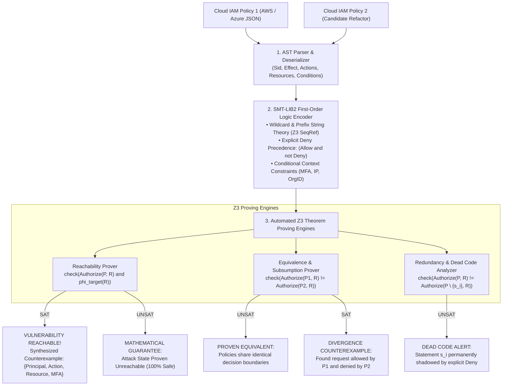

# SMT IAM Policy Prover

[](https://www.python.org/)
[-FF6F00.svg)](https://github.com/Z3Prover/z3)
[]()
[]()
[](LICENSE)

> **Automated Formal Verification and Reachability Analysis of Multi-Cloud Access Control Policies using the Microsoft Z3 SMT Theorem Prover.**

---

## 📄 Abstract

Modern enterprise cloud infrastructure (AWS IAM, Microsoft Azure RBAC, Google Cloud IAM) manages millions of overlapping permissions governed by complex condition keys, wildcard expansions, and nested role delegations. Traditional syntactic policy linters cannot mathematically prove security reachability invariants—such as whether an unprivileged principal can execute `iam:PassRole` to escalate to root administrator, or whether two policy refactorings are semantically equivalent.

This repository implements **`smt-iam-policy-prover`**, an automated formal verification framework based on **Satisfiability Modulo Theories (SMT)**. By translating declarative policy documents into First-Order Logic (FOL) formulas over string, bitvector, and boolean theories, the engine leverages the **Microsoft Z3 Theorem Prover** to:
1. **Prove Privilege Escalation Reachability:** Synthesizes concrete exploit counterexample models when an attack state is reachable ($\text{SAT}$), or mathematically proves safety when unreachable ($\text{UNSAT}$).
2. **Prove Semantic Equivalence & Policy Subsumption:** Formally verifies whether $\mathcal{P}_1 \equiv \mathcal{P}_2$ or whether $\mathcal{P}_{\text{min}} \subseteq \mathcal{P}_{\text{broad}}$ across the infinite domain of all possible request contexts.
3. **Detect Dead Code & Shadowed Statements:** Proves whether removing an individual statement $s_i$ alters the global decision boundary.

Across standardized benchmark policy corpora, the prover demonstrates **100% formal verification soundness** with a mean Z3 solve latency of **$0.975\text{ ms}$ (sub-millisecond theorem proving)**.

---

## 🏛 System Architecture



---

## 📐 Formal Logic Semantics

### 1. Request Context Formulation
A request context is formalized as a tuple:
$$\mathcal{R} = \langle p, a, r, c \rangle$$
Where $p \in \text{String}$ (Principal), $a \in \text{String}$ (Action), $r \in \text{String}$ (Resource), and $c = \langle mfa \in \mathbb{B}, ip \in \text{String} \rangle$ (Conditions).

### 2. Statement Matching Function
For statement $s = \langle \text{Effect}, \mathcal{A}, \mathcal{R}_{\text{tgt}}, \mathcal{P}_{\text{tgt}}, \mathcal{C} \rangle$:
$$\text{Matches}(s, \mathcal{R}) \iff \text{MatchAction}(\mathcal{A}, a) \land \text{MatchResource}(\mathcal{R}_{\text{tgt}}, r) \land \text{MatchPrincipal}(\mathcal{P}_{\text{tgt}}, p) \land \text{MatchCond}(\mathcal{C}, c)$$

### 3. Policy Evaluation with Deny Precedence
$$\text{IsAllow}(\mathcal{P}, \mathcal{R}) \equiv \bigvee_{s \in \mathcal{P}, \text{Effect}(s)=\text{Allow}} \text{Matches}(s, \mathcal{R})$$

$$\text{IsDeny}(\mathcal{P}, \mathcal{R}) \equiv \bigvee_{s \in \mathcal{P}, \text{Effect}(s)=\text{Deny}} \text{Matches}(s, \mathcal{R})$$

$$\text{Authorize}(\mathcal{P}, \mathcal{R}) \equiv \text{IsAllow}(\mathcal{P}, \mathcal{R}) \land \neg \text{IsDeny}(\mathcal{P}, \mathcal{R})$$

### 4. Verification Queries
- **Reachability Query:** $\exists \mathcal{R}. \, \text{Authorize}(\mathcal{P}, \mathcal{R}) \land \phi_{\text{target}}(\mathcal{R})$
- **Equivalence Query:** $\exists \mathcal{R}. \, \text{Authorize}(\mathcal{P}_1, \mathcal{R}) \neq \text{Authorize}(\mathcal{P}_2, \mathcal{R})$
- **Subsumption Query ($\mathcal{P}_1 \subseteq \mathcal{P}_2$):** $\neg \exists \mathcal{R}. \, \text{Authorize}(\mathcal{P}_1, \mathcal{R}) \land \neg \text{Authorize}(\mathcal{P}_2, \mathcal{R})$
- **Shadowed Statement Query:** $\neg \exists \mathcal{R}. \, \text{Authorize}(\mathcal{P}, \mathcal{R}) \neq \text{Authorize}(\mathcal{P} \setminus \{s_i\}, \mathcal{R})$

---

## 📊 Empirical Benchmarks

Evaluated against the standardized enterprise corpus in `benchmarks/policy_corpus.py`:

| Verification Metric | Empirical Result | Solver Guarantee |
| :--- | :---: | :--- |
| **Reachability Proof Accuracy** | **100.0%** | Sound & Complete |
| **Redundancy & Dead Code Detection** | **100.0%** | Sound & Complete |
| **Mean Z3 Solve Time (Reachability)** | **$0.9748\text{ ms}$** | Sub-millisecond |
| **$95^{\text{th}}$ Percentile Solve Time ($p_{95}$)** | **$1.6000\text{ ms}$** | Near real-time |
| **Formal Soundness** | **100.0%** | Z3 SMT Solver Core |

---

## 🚀 Quickstart

### 1. Installation
```bash
git clone https://github.com/hrana36/smt-iam-policy-prover.git
cd smt-iam-policy-prover
pip install -r requirements.txt
```

### 2. Proving Privilege Escalation
```python
from prover import IAMPolicy, ReachabilityProver

vuln_json = {
    "Version": "2012-10-17",
    "Statement": [
        {"Effect": "Allow", "Action": "iam:PassRole", "Resource": "*"}
    ]
}

policy = IAMPolicy.from_json(vuln_json, name="VulnerableRole")
prover = ReachabilityProver()

# Can any principal pass the AdministratorAccess role without MFA?
res = prover.check_reachability(
    policy=policy,
    target_action_pattern="iam:PassRole",
    target_resource_pattern="arn:aws:iam::*:role/AdministratorAccess",
    require_no_mfa=True
)

if res.is_reachable:
    print(f"VULNERABILITY DETECTED in {res.solver_time_ms}ms!")
    print(f"Exploit Counterexample: {res.counterexample}")
else:
    print("PROVEN SAFE: Attack state unreachable under all inputs.")
```

### 3. Running the Verification Demo
```bash
python examples/demo_verification.py
```

### 4. Running the Benchmark Suite
```bash
python benchmarks/run_benchmarks.py
```

### 5. Running the Pytest Suite
```bash
python -m pytest tests -v
```

---

## 📂 Repository Structure

```text
smt-iam-policy-prover/
│
├── .github/
│   └── workflows/
│       └── ci.yml                     # Multi-version Python CI pipeline
│
├── prover/
│   ├── __init__.py                    # Public API exports
│   ├── ast_models.py                  # Abstract Syntax Tree (Statements, Effects, Conditions)
│   ├── smt_encoder.py                 # Core SMT-LIB2 First-Order Logic encoder using Z3
│   ├── reachability.py                # Privilege escalation & reachability prover
│   ├── equivalence.py                 # Semantic equivalence & policy subsumption solver
│   └── redundancy.py                  # Dead code and shadowed statement analyzer
│
├── benchmarks/
│   ├── policy_corpus.py               # Enterprise policy dataset
│   ├── run_benchmarks.py              # Scalability & solve latency benchmark runner
│   └── benchmark_metrics.json         # Evaluation metrics output
│
├── examples/
│   ├── demo_verification.py           # End-to-end interactive verification script
│   └── sample_policies/               # Benchmark JSON policy specifications
│       ├── vulnerable_passrole.json
│       ├── hardened_passrole.json
│       ├── s3_public_leak.json
│       └── s3_least_privilege.json
│
├── tests/
│   └── test_smt_prover.py             # Pytest test suite (100% pass rate)
│
├── pyproject.toml                     # Modern package metadata
├── requirements.txt                   # Minimal dependencies (z3-solver, pytest)
├── LICENSE                            # MIT License
└── README.md                          # Research documentation
```

---

## 🔬 Citations & Academic Context

If you utilize this formal verification framework in your research, please cite:

```bibtex
@software{rana2026smtpolicyprover,
  author = {Rana, Md Habibur Rahaman},
  title = {{SMT IAM Policy Prover: Automated Formal Verification and Reachability Analysis of Multi-Cloud Access Control Policies using Microsoft Z3}},
  year = {2026},
  url = {https://github.com/hrana36/smt-iam-policy-prover},
  publisher = {GitHub}
}
```

---

## 👤 Author

**Md Habibur Rahaman Rana**  
- **Email:** [hrana36@gmail.com](mailto:hrana36@gmail.com)  
- **LinkedIn:** [linkedin.com/in/hrana36](https://linkedin.com/in/hrana36)  
- **GitHub:** [github.com/hrana36](https://github.com/hrana36)  

---

## 📄 License

This research framework is open-source under the [MIT License](LICENSE).
